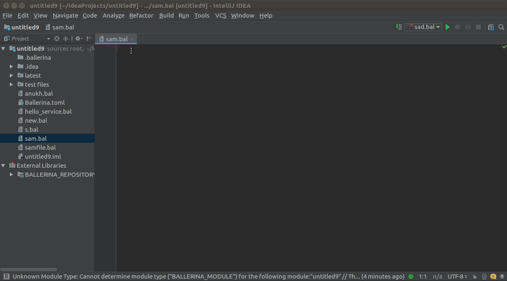
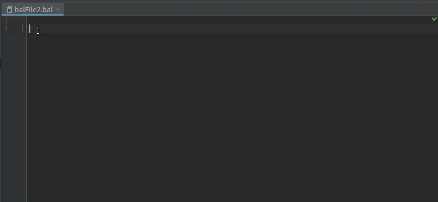
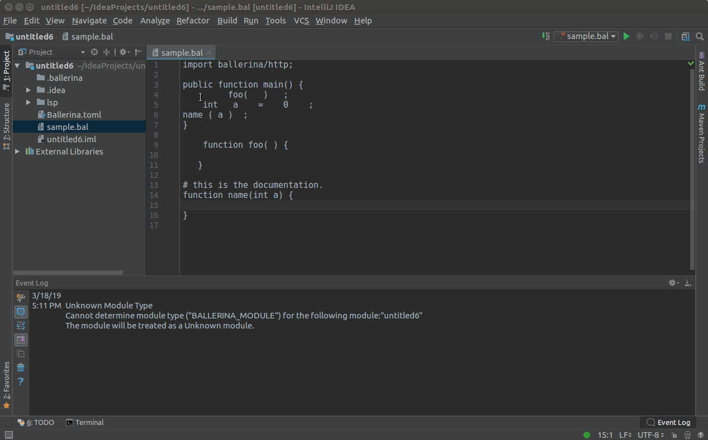
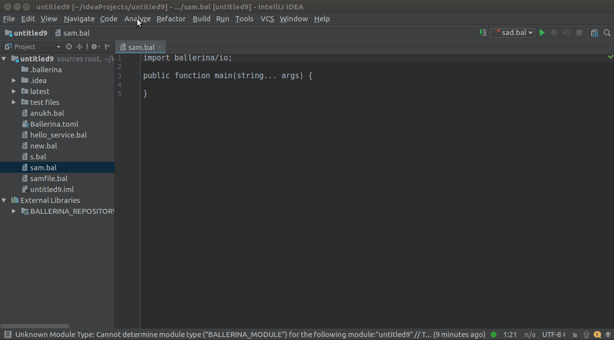
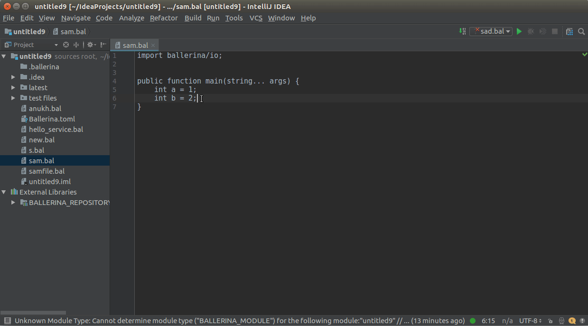
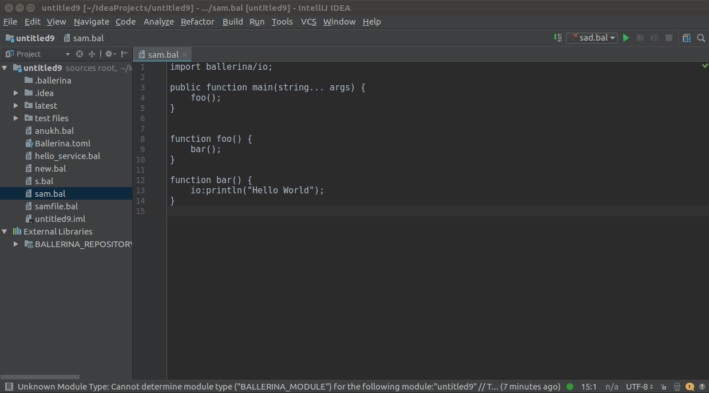
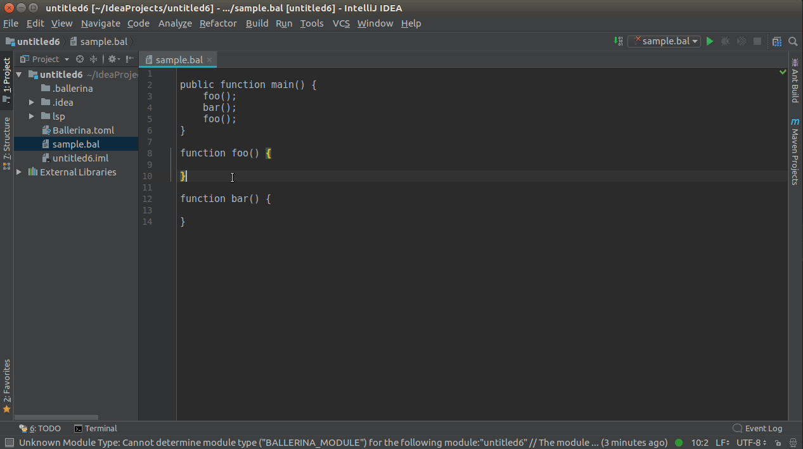
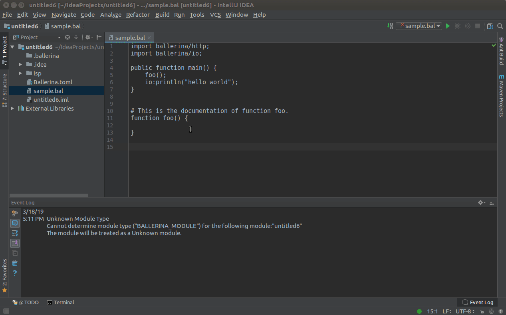
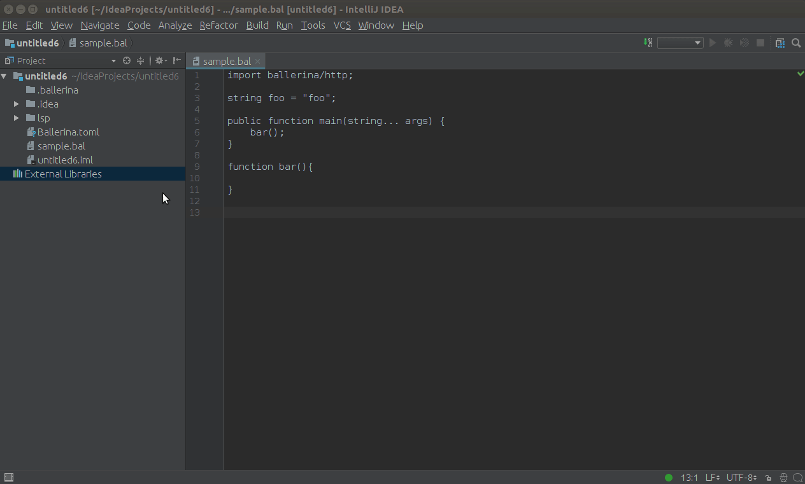
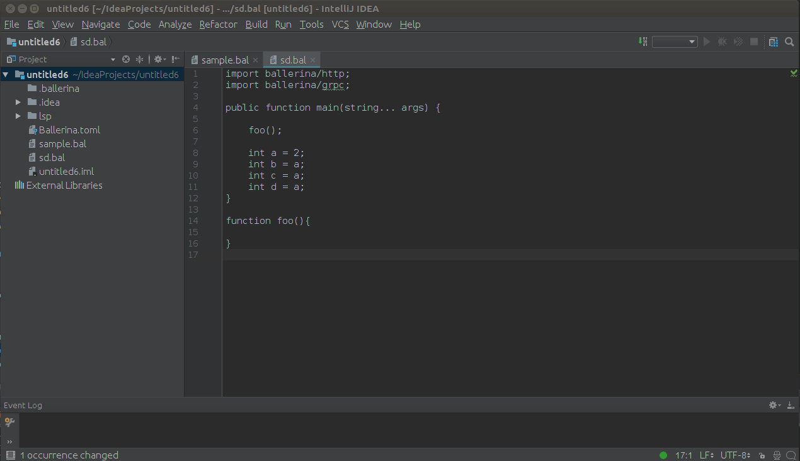

# Features

LSP4IntelliJ surfaces these LSP capabilities in JetBrains IDEs.

> **Note:** Features are mainly tested on IntelliJ IDEA.

## Table of Contents

<!-- The TOC below is auto-generated. To regenerate, run: npx markdown-toc -i docs/features.md --maxdepth 3 -->

<!-- toc -->

- [Code Completion (with code snippet support)](#code-completion-with-code-snippet-support)
- [Code Formatting](#code-formatting)
- [Diagnostics](#diagnostics)
- [Code Actions](#code-actions)
- [Go to Definition](#go-to-definition)
- [Go to References / Find Usages](#go-to-references--find-usages)
- [Hover Support](#hover-support)
- [Workspace Symbols](#workspace-symbols)
- [Renaming Support](#renaming-support)
- [LSP Inspector](#lsp-inspector)
- [Work in progress](#work-in-progress)

<!-- tocstop -->

---

## Code Completion (with code snippet support)

Press `Ctrl+Space` to see the completion items list, which depends on your cursor position. Code completion items also pop up automatically based on your language-server-specific trigger characters.

For code snippets, use `Tab`/`Enter` to navigate to the next placeholder position, or `Esc` to apply the snippet with default values.

## Code Formatting

Navigate to **Code → Reformat Code** to open a dialog that lets you format the whole file or a selected range.

## Diagnostics

To see diagnostics (errors, warnings, etc.), hover over them to view the message.

## Code Actions

Hover over any diagnostic highlight to view and apply related code actions via the light bulb that pops up.

## Go to Definition

Use `Ctrl+Click` (`Cmd+Click` on macOS) to navigate to a symbol's definition.

## Go to References / Find Usages

Use `Ctrl+Click` (`Cmd+Click` on macOS) or `Shift+Alt+F7` on a symbol to view its references/usages.

## Hover Support

Hover over an element while pressing `Ctrl` (`Cmd` on macOS) to view its documentation, if available.

## Workspace Symbols

Click **Navigate** in the top menu, then **Symbol…**, and enter the name of the symbol you want to search for.

## Renaming Support

Place the cursor on the element to rename and press `Shift+F6` to trigger in-place renaming.

## LSP Inspector

Open **View → Tool Windows → LSP Inspector**, or click the language server icon in the status bar and choose **Open LSP Inspector**. If the project runs more than one language server, pick one from the dropdown at the left of the toolbar.

- **Log** shows the server's status changes, crashes, and the log and show-message notifications it sends. Use the level and source dropdowns to filter it; **Error** shows only crashes, error messages, and failed requests.
- To see JSON-RPC traffic, set **Trace** to `MESSAGES` (method, id and direction of each message) or `VERBOSE` (the full payload as well). Each response shows the method of the request it answers and how long the server took, for example `textDocument/hover (12) 38 ms`. Tracing is `OFF` by default and is set per server.
- **Timeouts** shows, per request type, how many requests got a response within their timeout and how many timed out.
- **Connected Files** lists the files currently open on the server.

**Clear** empties the selected server's log, and **Scroll to End** jumps to the newest entry.

> **Note:** The tool window appears only if the plugin using LSP4IntelliJ registers it. See [LSP Inspector](../README.md#lsp-inspector) in the README.

---

## Work in progress

- Signature Help
